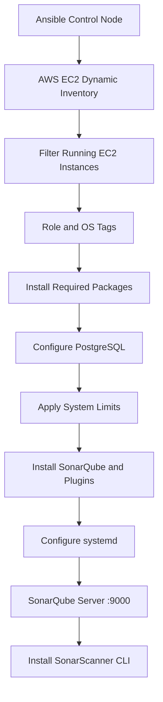

# SonarQube Server Setup Using Ansible

<p align="center">
 
</p>

---

# Document Information

| Author | Created On | Version | L0 Reviewer | L1 Reviewer | L2 Reviewer |
|---|---|---|---|---|---|
| Ritu | 19/10/2026 | 1.0 | Liyakhat/Anirudh | Aman Raj | Sandeep Rawat/Ravindra |

---

# Table of Contents

1. [Introduction](#1-introduction)
2. [Purpose and Features](#2-purpose-and-features)
3. [Prerequisites and Dependencies](#3-prerequisites-and-dependencies)
4. [Architecture](#4-architecture)
5. [Repository Structure](#5-repository-structure)
6. [Implementation](#6-implementation)
7. [Execution](#7-execution)
8. [Verification and Monitoring](#8-verification-and-monitoring)
9. [Contact Information](#9-contact-information)
10. [References](#10-references)

---

# 1. Introduction

This project automates SonarQube Server installation and configuration on AWS EC2 using Ansible and AWS EC2 dynamic inventory.

The playbook installs required packages, configures PostgreSQL, applies Linux system settings, installs SonarQube and selected plugins, configures systemd, and installs SonarScanner CLI.

---
# 2. Purpose and Features

**Objectives:**
- Automate SonarQube installation and configuration.
- Discover EC2 instances using AWS tags.
- Configure PostgreSQL as the application database.
- Apply required kernel parameters and user limits.
- Manage SonarQube through systemd.
- Install selected plugins and SonarScanner CLI.

| Feature | Description |
|---|---|
| **Dynamic Inventory** | Discovers running EC2 instances in `ap-south-1`. |
| **Tag-Based Targeting** | Targets instances tagged `Role=sonarqube`. |
| **OS-Specific Packages** | Supports Debian and Red Hat package tasks. |
| **Database Setup** | Configures PostgreSQL database and user. |
| **Versioned Installation** | Installs SonarQube under `/opt/sonarqube-<version>`. |
| **Plugin Management** | Installs configured server-side plugins. |
| **Service Management** | Enables and starts SonarQube through systemd. |

---

# 3. Prerequisites and Dependencies

## Infrastructure Requirements

| Requirement | Details |
|---|---|
| **AWS Region** | `ap-south-1` |
| **EC2 State** | Running |
| **EC2 Tags** | `Role=sonarqube`, `OS=ubuntu` or `OS=rhel` |
| **SSH Access** | Valid private key and network connectivity |
| **Privileges** | Remote user must have `sudo` access |
| **Network** | SSH access and restricted TCP port `9000` |

## Control Node Dependencies

- Ansible
- AWS credentials with required EC2 permissions
- Python packages: `boto3`, `botocore`
- SSH private key
- Required Ansible collections

Install the collections and Python dependencies:

```bash
ansible-galaxy collection install amazon.aws ansible.posix community.general

python3 -m pip install boto3 botocore
```

The target host requires a supported OS, Java 21 package, PostgreSQL packages, and standard download utilities.

---

## 4. Architecture


---

# 5. Repository Structure

```text
Sonarqube_Setup/
├── ansible.cfg
├── inventory/
│   └── aws_ec2.yml
├── group_vars/
│   ├── os_rhel.yml
│   └── os_ubuntu.yml
├── playbook.yml
├── templates/
│   ├── sonar.properties.j2
│   └── sonarqube.service.j2
└── README.md
```

---

# 6. Implementation


## 6.1 Package and Database Setup

The playbook installs Java 21, PostgreSQL, and supporting utilities using the appropriate package manager.

PostgreSQL configuration:

| Setting | Value |
|---|---|
| **Database** | `sonar` |
| **Database User** | `sonar` |
| **JDBC URL** | `jdbc:postgresql://localhost:5432/sonar` |

The playbook creates the database role and database, then grants the configured privileges.

## 6.2 System Configuration

The playbook configures kernel parameters in `/etc/sysctl.d/99-sonarqube.conf` and applies user limits to the `sonar` account.

| Parameter | Value |
|---|---:|
| **`vm.max_map_count`** | `524288` |
| **`fs.file-max`** | `131072` |
| **`nofile` soft/hard limit** | `131072` |
| **`nproc` soft/hard limit** | `8192` |

Verify these values against the requirements of the selected SonarQube release.

## 6.3 SonarQube Installation

| Setting | Configured Value |
|---|---|
| **Service User/Group** | `sonar` |
| **Home Directory** | `/var/lib/sonar` |
| **Version** | `26.10.0.133078` |
| **Installation** | `/opt/sonarqube-26.10.0.133078` |
| **Stable Symlink** | `/opt/sonarqube` |
| **Web Port** | `9000` |

The playbook configures PostgreSQL connectivity, web settings, data and temporary directories through `templates/sonar.properties.j2`.

## 6.4 Plugins and systemd

The configured plugins are:

| Plugin | Version |
|---|---|
| **Community Branch Plugin** | `1.21.0` |
| **Sonar Ansible Plugin** | `2.5.1` |
| **Dependency-Check Plugin** | `3.0.0` |

Plugin compatibility must be verified against the selected SonarQube version.

The `templates/sonarqube.service.j2` template creates `/etc/systemd/system/sonarqube.service`. The playbook enables and starts the service and waits for port `9000`.

## 6.5 SonarScanner CLI

The playbook installs SonarScanner CLI version `5.0.1.3006` and creates the command symlink:

```text
/usr/local/bin/sonar-scanner
```

---

# 7. Execution

Run these commands from the repository directory.

## Step 1: Validate Dynamic Inventory

```bash
ansible-inventory --graph
ansible-inventory --list
```

## Step 2: Test Connectivity

```bash
ansible role_sonarqube -m ping
```

## Step 3: Validate Syntax

```bash
ansible-playbook playbook.yml --syntax-check
```

## Step 4: Preview Changes

```bash
ansible-playbook playbook.yml --check --diff
```

Check mode may not predict every change made by shell commands or runtime-dependent tasks.

## Step 5: Run the Playbook

```bash
ansible-playbook playbook.yml
```

Review the inventory, variables, and target hosts before execution.

---

# 8. Verification and Monitoring

| Check | Command |
|---|---|
| **SonarQube status** | `sudo systemctl status sonarqube` |
| **PostgreSQL status** | `sudo systemctl status postgresql` |
| **Port 9000** | `sudo ss -lntp \| grep 9000` |
| **SonarScanner version** | `sonar-scanner --version` |
| **Service logs** | `sudo journalctl -u sonarqube -n 100 --no-pager` |
| **Disk usage** | `df -h` |
| **Memory usage** | `free -h` |

Access the web interface using:

```text
http://<EC2-PUBLIC-IP>:9000
```

The URL is accessible only when the service is running and network rules permit access.

---

# 9. Contact Information

| Name | Email |
|---|---|
| Ritu | [ritu.dogra.snaatak@mygurukulam.co](mailto:ritu.dogra.snaatak@mygurukulam.co) |

---

# 10. References

| Reference | Purpose |
|---|---|
| [SonarQube Documentation](https://docs.sonarsource.com/sonarqube-server/) | Server setup and configuration |
| [Ansible Documentation](https://docs.ansible.com/) | Playbooks and modules |
| [AWS EC2 Inventory Plugin](https://docs.ansible.com/ansible/latest/collections/amazon/aws/aws_ec2_inventory.html) | Dynamic EC2 inventory |
| [Ansible POSIX Collection](https://docs.ansible.com/ansible/latest/collections/ansible/posix/index.html) | System configuration modules |
| [Community General Collection](https://docs.ansible.com/ansible/latest/collections/community/general/index.html) | Additional Ansible modules |
| [SonarScanner Documentation](https://docs.sonarsource.com/sonarqube-server/analyzing-source-code/scanners/sonarscanner/) | Scanner installation and usage |

---
