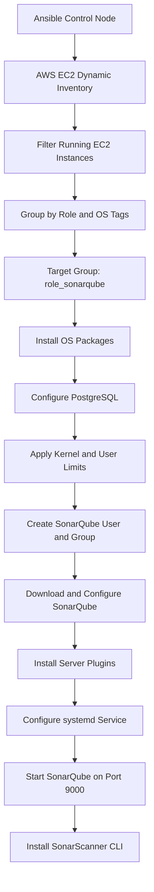

p align="center">
  
</p>

---

# SonarQube Server Setup Using Ansible

## Document Information

| Author | Created On | Version | L0 Reviewer | L1 Reviewer | L2 Reviewer |
| ------ | ---------- | ------- | --------- | ---------- | ---------- |
| Ritu | 19/10/2026 | 1.0 | Liyakhat/Anirudh | Aman Raj | Sandeep Rawat/Ravindra |

---

## Table of Contents

1. [Introduction](#1-introduction)
2. [Purpose](#2-purpose)
3. [Key Features](#3-key-features)
4. [Prerequisites](#4-prerequisites)
5. [Dependencies](#5-dependencies)
6. [Architecture](#6-architecture)
7. [Implementation](#7-implementation)
8. [Verification and Monitoring](#8-verification-and-monitoring)
9. [Maintenance](#9-maintenance)
10. [Troubleshooting](#10-troubleshooting)
11. [FAQs](#11-faqs)
12. [How to Run the Playbook](#12-how-to-run-the-playbook)
13. [Security Considerations](#13-security-considerations)
14. [Contact Information](#14-contact-information)
15. [References](#15-references)

---

# 1. Introduction

This project automates the installation and configuration of a SonarQube server using Ansible. The playbook targets AWS EC2 instances discovered through Ansible's AWS EC2 dynamic inventory.

The automation installs the required operating-system packages, configures PostgreSQL for SonarQube, applies Linux kernel and user limits, creates a dedicated service account, installs SonarQube and selected server-side plugins, configures a systemd service, and installs the SonarScanner CLI.

SonarQube is a code-quality platform that helps teams inspect source code for maintainability issues, bugs, and security-related findings.

# 2. Purpose

The purpose of this setup is to make SonarQube deployment repeatable and easier to maintain through configuration management.

Objectives:

- Automate the installation of SonarQube and its supporting packages.
- Discover running EC2 instances dynamically using AWS tags.
- Configure PostgreSQL database settings used by SonarQube.
- Apply system settings required by the configured SonarQube search engine.
- Run SonarQube under a dedicated Linux user and systemd service.
- Install selected SonarQube plugins and SonarScanner CLI.
- Provide commands for deployment checks and troubleshooting.

# 3. Key Features

| Feature | Description |
| --- | --- |
| **AWS EC2 Dynamic Inventory** | Discovers running EC2 instances in the configured AWS region. |
| **Tag-Based Targeting** | Creates Ansible groups from EC2 `Role` and `OS` tags. |
| **OS-Specific Packages** | Uses `apt` for Debian-family systems and `dnf` for Red Hat-family systems. |
| **PostgreSQL Setup** | Starts PostgreSQL and creates the configured database and database user. |
| **System Prerequisites** | Configures selected kernel parameters and user limits. |
| **Dedicated Service Account** | Creates a `sonar` group and `sonar` user. |
| **Versioned Installation** | Uses a configured SonarQube version and a stable `/opt/sonarqube` symlink. |
| **Plugin Installation** | Downloads the configured Community Branch, Ansible, and Dependency-Check plugins. |
| **Systemd Integration** | Deploys a service definition and enables SonarQube at system startup. |
| **SonarScanner CLI** | Installs the configured scanner version and links it into `/usr/local/bin`. |

# 4. Prerequisites

## 4.1 Infrastructure and Access

| Requirement | Details |
| --- | --- |
| **AWS Account** | Access to the AWS account containing the target EC2 instance. |
| **AWS Region** | `ap-south-1`, as configured in `inventory/aws_ec2.yml`. |
| **EC2 State** | The dynamic inventory filters for instances in the `running` state. |
| **EC2 Tags** | Target instances must have `Role=sonarqube`; OS-specific grouping uses the `OS` tag. |
| **SSH Access** | The control node must be able to connect to the target instance over SSH. |
| **Private Key** | `ansible.cfg` references `/home/ritu/crypt.pem`; update this path for your environment. |
| **Privilege Escalation** | The remote account must be able to use `sudo`, because the playbook uses `become: true`. |
| **Network Access** | Allow SSH from the control node and permit TCP `9000` from approved client networks. |
| **Resources** | Allocate CPU, memory, and disk according to the selected SonarQube version and workload. |

## 4.2 Supported OS Package Paths

The playbook defines package lists for Debian-family and Red Hat-family operating systems:

- Debian/Ubuntu: `openjdk-21-jdk`, `unzip`, `curl`, `wget`, `tar`, `postgresql`, and `postgresql-contrib`.
- Red Hat-family: `java-21-openjdk-devel`, `unzip`, `curl`, `wget`, `tar`, `postgresql-server`, and `postgresql-contrib`.

> **Note:** The playbook includes package tasks for both OS families. PostgreSQL initialization and service behavior can differ by distribution; validate the Red Hat-family database setup on the target OS before relying on it.

# 5. Dependencies

## 5.1 Control Node

The Ansible control node requires:

| Dependency | Purpose |
| --- | --- |
| Ansible | Runs the playbook and manages the remote host. |
| AWS CLI credentials or another supported AWS credential source | Allows the EC2 inventory plugin to query AWS. |
| `boto3` and `botocore` | Python dependencies commonly required by the AWS EC2 inventory plugin. |
| `amazon.aws` collection | Provides `amazon.aws.aws_ec2` dynamic inventory. |
| `ansible.posix` collection | Provides the `sysctl` module used in the playbook. |
| `community.general` collection | Provides the `pam_limits` module used in the playbook. |
| SSH private key | Authenticates the connection to the EC2 instance. |

Install the required collections:

```bash
ansible-galaxy collection install amazon.aws ansible.posix community.general
```

Ensure the Python AWS SDK dependencies are installed in the same Python environment used by Ansible. For example:

```bash
python3 -m pip install boto3 botocore
```

## 5.2 Target Host

The target host requires SSH connectivity and a supported package manager. The playbook installs Java, PostgreSQL-related packages, and supporting utilities through Ansible.

# 6. Architecture

## 6.1 Deployment Flow



## 6.2 Components

| Component | Role |
| --- | --- |
| **Ansible Control Node** | Executes the playbook and connects to target EC2 instances. |
| **AWS EC2 Dynamic Inventory** | Retrieves running EC2 instances in `ap-south-1` and groups them using tags. |
| **PostgreSQL** | Stores SonarQube application data using the configured JDBC connection. |
| **SonarQube Server** | Provides the web interface and code-analysis platform on port `9000`. |
| **SonarQube Plugins** | Adds the configured plugin functionality. |
| **SonarScanner CLI** | Provides the `sonar-scanner` command for code-analysis workflows. |
| **systemd** | Manages the SonarQube service lifecycle. |

# 7. Implementation

## 7.1 Repository Structure

```text
Sonarqube_Setup/
├── ansible.cfg
├── inventory/
│   └── aws_ec2.yml
├── group_vars/
│   ├── os_rhel.yml
│   └── os_ubuntu.yml
├── playbook.yml
├── templates/
│   ├── sonar.properties.j2
│   └── sonarqube.service.j2
└── README.md
```

## 7.2 Ansible Configuration

The `ansible.cfg` file sets the dynamic inventory path, disables SSH host-key checking, and specifies the private-key path.

```ini
[defaults]
inventory = inventory/aws_ec2.yml
host_key_checking = False
private_key_file = /home/ritu/crypt.pem
```

Update the private-key path to match the control node. Disabling host-key checking is convenient for a POC but is not recommended for security-sensitive environments.

## 7.3 AWS EC2 Dynamic Inventory

The file `inventory/aws_ec2.yml` uses the `amazon.aws.aws_ec2` inventory plugin.

Its current configuration:

- Queries region `ap-south-1`.
- Includes EC2 instances whose state is `running`.
- Uses the public IP address as the inventory hostname.
- Creates groups from `tags.Role` and `tags.OS`.
- Uses the prefixes `role_` and `os_`.

The playbook targets the generated group `role_sonarqube`. Therefore, the target EC2 instance must have the AWS tag:

| Tag Key | Expected Value | Purpose |
| --- | --- | --- |
| `Role` | `sonarqube` | Places the instance in `role_sonarqube`. |
| `OS` | For example, `ubuntu` or `rhel` | Creates an OS-specific group for variable selection. |

The `group_vars/os_ubuntu.yml` file sets `ansible_user: ubuntu`, while `group_vars/os_rhel.yml` sets `ansible_user: ec2-user`.

Check whether the inventory can discover the target:

```bash
ansible-inventory --graph
ansible-inventory --list
```

## 7.4 Package Installation

The playbook installs packages according to `ansible_os_family`:

- `Debian`: uses `ansible.builtin.apt` and updates the package cache.
- `RedHat`: uses `ansible.builtin.dnf` and updates the package cache.

The package lists include Java 21, archive/download utilities, and PostgreSQL packages.

## 7.5 PostgreSQL Configuration

The playbook:

1. Ensures the `postgresql` service is started and enabled.
2. Creates the PostgreSQL role configured by `sonar_db_user` if it does not exist.
3. Creates the database configured by `sonar_db_name` if it does not exist.
4. Grants the configured user privileges on the database.

Current playbook defaults:

| Variable | Configured Value |
| --- | --- |
| `sonar_db_name` | `sonar` |
| `sonar_db_user` | `sonar` |
| `sonar_jdbc_url` | `jdbc:postgresql://localhost:5432/sonar` |

The database password is currently defined as a playbook variable. For shared repositories and production use, store it in Ansible Vault or a secret manager rather than committing a plaintext secret.

## 7.6 Kernel Parameters and User Limits

The playbook configures the following kernel parameters in `/etc/sysctl.d/99-sonarqube.conf`:

| Parameter | Configured Value | Purpose |
| --- | ---: | --- |
| `vm.max_map_count` | `524288` | Sets the maximum number of memory map areas per process. |
| `fs.file-max` | `131072` | Sets the system-wide maximum number of open file handles. |
| `fs.suid_dumpable` | `0` | Controls core-dump behavior for set-user-ID programs. |

It also configures `nofile` and `nproc` limits for the `sonar` account using `community.general.pam_limits`.

| Limit | Soft Value | Hard Value |
| --- | ---: | ---: |
| `nofile` | `131072` | `131072` |
| `nproc` | `8192` | `8192` |

Confirm the values against the requirements of the exact SonarQube release being deployed.

## 7.7 Dedicated User and Installation Directory

The playbook creates:

- Group: `sonar`
- User: `sonar`
- Home directory: `/var/lib/sonar`
- Versioned installation directory: `/opt/sonarqube-26.10.0.133078`
- Standard symlink: `/opt/sonarqube`

The version and install path are controlled by `sonar_version` and `sonar_install_dir` in `playbook.yml`. The playbook also applies ownership and permissions to the versioned directory and makes the startup script executable.

## 7.8 SonarQube Configuration

The template `templates/sonar.properties.j2` writes the PostgreSQL JDBC settings, web listener, data/temp paths, Java memory settings, and update-center setting to:

```text
/opt/sonarqube/conf/sonar.properties
```

Configured web settings include:

| Setting | Value |
| --- | --- |
| Web host | `0.0.0.0` |
| Web port | `9000` |
| Web context | Empty string |
| Data directory | `/opt/sonarqube/data` |
| Temporary directory | `/opt/sonarqube/temp` |

The web listener binds to all network interfaces. Restrict access to port `9000` using the EC2 security group and any applicable host firewall.

## 7.9 Server-Side Plugins

The playbook downloads the following plugin JARs into the SonarQube plugin directory:

| Plugin | Configured Release |
| --- | --- |
| SonarQube Community Branch Plugin | `1.21.0` |
| Sonar Ansible Plugin | `2.5.1` |
| Sonar Dependency-Check Plugin | `3.0.0` |

Plugin compatibility depends on the exact SonarQube release. Verify compatibility before using these plugin versions in a production environment. The playbook notifies the SonarQube restart handler when plugin files are changed.

## 7.10 systemd Service

The template `templates/sonarqube.service.j2` creates:

```text
/etc/systemd/system/sonarqube.service
```

The service runs the SonarQube startup script as the `sonar` user and group, defines file/process limits, and uses `Restart=always`.

The playbook reloads systemd when needed, enables the service at boot, starts it, and waits for port `9000` to become available.

## 7.11 SonarScanner CLI

The playbook downloads and extracts the configured SonarScanner CLI version `5.0.1.3006`, then creates this symlink:

```text
/usr/local/bin/sonar-scanner
```

This makes the scanner command available through the system `PATH`.

# 8. Verification and Monitoring

Run these commands on the relevant host after deployment.

| Check | Command | Expected Use |
| --- | --- | --- |
| Discover targets | `ansible-inventory --graph` | Confirm dynamic groups and target hosts. |
| Test connectivity | `ansible role_sonarqube -m ping` | Confirm Ansible can connect to the target. |
| Check service | `sudo systemctl status sonarqube` | Inspect service state. |
| Check PostgreSQL | `sudo systemctl status postgresql` | Inspect database service state. |
| Check listening port | `sudo ss -lntp \| grep 9000` | Confirm a process is listening on port `9000`. |
| Check scanner | `sonar-scanner --version` | Confirm the scanner command is available. |
| View SonarQube logs | `sudo journalctl -u sonarqube -n 100 --no-pager` | Inspect recent service logs. |
| Follow logs | `sudo journalctl -u sonarqube -f` | Follow service logs in real time. |
| Check disk | `df -h` | Check available disk space. |
| Check memory | `free -h` | Check available memory. |

Once the service is running and network access is allowed, open:

```text
http://<EC2-PUBLIC-IP>:9000
```

Use the instance's actual public IP or configured DNS name. Do not expose the SonarQube web interface publicly without appropriate network restrictions and security controls.

# 9. Maintenance

| Task | Command / Action |
| --- | --- |
| Check SonarQube status | `sudo systemctl status sonarqube` |
| Start SonarQube | `sudo systemctl start sonarqube` |
| Stop SonarQube | `sudo systemctl stop sonarqube` |
| Restart SonarQube | `sudo systemctl restart sonarqube` |
| Reload systemd definitions | `sudo systemctl daemon-reload` |
| Check PostgreSQL | `sudo systemctl status postgresql` |
| Review service logs | `sudo journalctl -u sonarqube -n 100 --no-pager` |
| Check disk capacity | `df -h` |
| Check memory | `free -h` |

Before changing SonarQube or plugin versions, review compatibility and take an appropriate backup of the database and required application data.

# 10. Troubleshooting

| Issue | Checks / Resolution |
| --- | --- |
| **No EC2 hosts discovered** | Confirm AWS credentials, region `ap-south-1`, instance state, inventory plugin dependencies, and EC2 tags. Run `ansible-inventory --list`. |
| **Target is not in `role_sonarqube`** | Verify the EC2 tag `Role=sonarqube` and rerun the inventory command. |
| **SSH connection fails** | Verify the private-key path, SSH username, security-group rules, network reachability, and key permissions. |
| **Ansible privilege escalation fails** | Confirm the remote account has working `sudo` privileges. |
| **Package installation fails** | Check OS family, package repositories, DNS, and outbound network access. |
| **PostgreSQL service fails** | Inspect `sudo systemctl status postgresql` and `sudo journalctl -u postgresql -n 100 --no-pager`. Validate distribution-specific PostgreSQL initialization. |
| **SonarQube does not start** | Check `sudo systemctl status sonarqube` and `sudo journalctl -u sonarqube -n 100 --no-pager`; review Java, memory, database connectivity, permissions, and configuration. |
| **Port 9000 is unreachable** | Check service status, listener binding, EC2 security-group rules, host firewall, and client network access. |
| **Plugin causes startup failure** | Check compatibility between the plugin and SonarQube version; remove or replace an incompatible plugin and restart as appropriate. |
| **Scanner command not found** | Confirm the extracted directory exists and `/usr/local/bin/sonar-scanner` points to the scanner binary. |

# 11. FAQs

### Which EC2 instances does this playbook target?

The dynamic inventory filters for running EC2 instances in `ap-south-1`. The playbook targets instances grouped under `role_sonarqube`, generated from the `Role=sonarqube` tag.

### Which port does SonarQube use?

The playbook configures SonarQube to use TCP port `9000`.

### Which database is configured?

PostgreSQL is configured with database name `sonar`, user `sonar`, and JDBC URL `jdbc:postgresql://localhost:5432/sonar`.

### Where is SonarQube installed?

The versioned installation is under `/opt/sonarqube-<version>`, with `/opt/sonarqube` used as the standard symlink.

### How is SonarQube managed?

The playbook deploys a systemd unit named `sonarqube`, then enables and starts it.

### Does the playbook install SonarScanner?

Yes. It downloads the configured SonarScanner CLI archive and links its binary to `/usr/local/bin/sonar-scanner`.

### Does this README confirm a successful deployment?

No. This document describes the implementation shown in the supplied Ansible files and provides verification commands. Deployment success must be confirmed by running the playbook and checking the target host.

# 12. How to Run the Playbook

Run the following commands from the repository directory on the Ansible control node.

## 12.1 Validate Inventory

```bash
ansible-inventory --graph
ansible-inventory --list
```

## 12.2 Test Connectivity

```bash
ansible role_sonarqube -m ping
```

## 12.3 Validate Playbook Syntax

```bash
ansible-playbook playbook.yml --syntax-check
```

## 12.4 Review Planned Changes

```bash
ansible-playbook playbook.yml --check --diff
```

> Check mode is a preview and may not fully predict tasks that use shell commands or depend on runtime state.

## 12.5 Run the Playbook

```bash
ansible-playbook playbook.yml
```

The playbook uses the inventory configured in `ansible.cfg`. Review the inventory and variables before running it against an environment.

# 13. Security Considerations

- **Protect credentials:** The supplied playbook defines the PostgreSQL password as a plaintext variable. Move it to Ansible Vault or a secrets manager before committing or sharing the repository.
- **Restrict port 9000:** Permit access only from approved client or administrative networks.
- **Review SSH settings:** `host_key_checking = False` reduces SSH host identity verification; enable host-key checking in security-sensitive environments.
- **Use least privilege:** Limit AWS permissions to the inventory and deployment operations that are actually required.
- **Validate plugins:** Confirm each plugin's compatibility and source integrity before installation.
- **Back up data:** Maintain and test a database backup and recovery process appropriate to the deployment.
- **Validate OS support:** Confirm that the selected SonarQube version, Java version, and operating system are supported together.

# 14. Contact Information

| Name | Email Address |
| --- | --- |
| **Ritu** | [ritu.dogra.snaatak@mygurukulam.co](mailto:ritu.dogra.snaatak@mygurukulam.co) |

# 15. References

| Reference | Purpose |
| --- | --- |
| [SonarQube Documentation](https://docs.sonarsource.com/sonarqube-server/) | Official SonarQube Server documentation. |
| [SonarQube Server Installation](https://docs.sonarsource.com/sonarqube-server/server-installation/) | Installation and server configuration guidance. |
| [Ansible Documentation](https://docs.ansible.com/) | Ansible playbooks, modules, configuration, and inventory. |
| [AWS EC2 Inventory Plugin](https://docs.ansible.com/ansible/latest/collections/amazon/aws/aws_ec2_inventory.html) | Dynamic inventory configuration for EC2. |
| [Ansible POSIX Collection](https://docs.ansible.com/ansible/latest/collections/ansible/posix/index.html) | POSIX modules, including `sysctl`. |
| [Community General Collection](https://docs.ansible.com/ansible/latest/collections/community/general/index.html) | Community modules, including `pam_limits`. |
| [SonarScanner CLI Documentation](https://docs.sonarsource.com/sonarqube-server/analyzing-source-code/scanners/sonarscanner/) | SonarScanner configuration and usage. |

---
